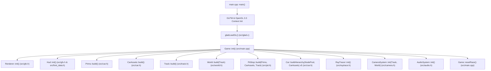
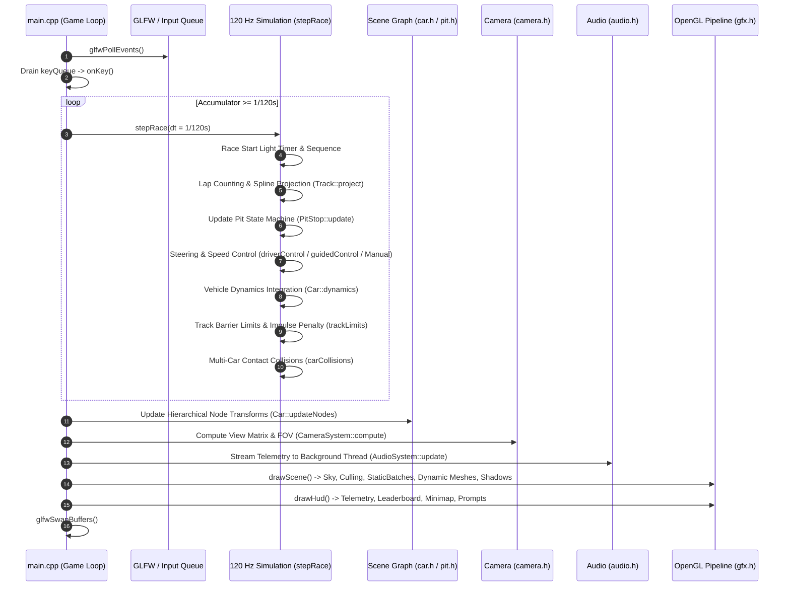
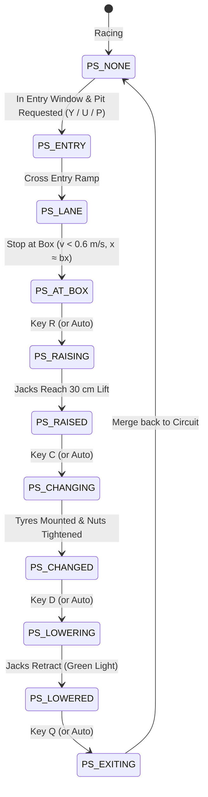

# Real-Time 3D Formula 1 Simulation: Architecture, Workflow & Algorithm Directory

This document provides a comprehensive technical breakdown of the Formula 1 racing and pit stop simulation codebase. It details the complete **code execution workflow** (from bootstrap to per-frame rendering), the **inter-file dependency graph**, and an **exhaustive inventory of all algorithms implemented in each file**.

---

## 1. System Architecture & File Structure

The project is built in **C++17** using **OpenGL 3.3 Core Profile**, **GLFW 3**, **GLAD**, and the native **Windows Multimedia (`waveOut`) API**. It uses a single translation unit compilation model with header-only modules:

```
src/
├── main.cpp        Application entry, game loop, physics sub-stepping, collision handling, rendering orchestrator, HUD
├── math3d.h        Linear algebra: vectors (vec2, vec3), 4x4 column-major matrices, transforms, inverse, normal matrix
├── gfx.h           OpenGL shaders (Gouraud, Phong, Sky, Decals, Shadows, Blit), MeshBuilder, frustum culling, StaticBatch, HUD
├── font_data.h     40 px font atlas bitmap data for text decals and HUD font rendering
├── track.h         Circuit spline, arc-length resampling, Frenet-Serret frame, spatial hash, curvature-based speed profile
├── car.h           Hierarchical scene graph (`Node`), 3D F1 models, vehicle dynamics (bicycle model), pure-pursuit AI driver
├── pit.h           11-stage pit stop state machine, 8-member articulated humanoid crew, hydraulic jacks, tyre physics
├── world.h         Procedural venue generation: asphalt, kerbs, barriers, tyre walls, 5 garages, grandstands, floodlights
├── camera.h        Nine camera controllers: Cockpit, Chase, Trackside, Overhead, Pit, Broadcast, Low Chase, Helicopter, Head-on
├── raytrace.h      CPU-based Whitted recursive ray tracer (spheres, boxes, cylinders, planes, reflections, hard shadows, AA)
├── audio.h         Procedural real-time multi-threaded audio synthesis: V6 engine harmonics, turbo whine, tyre skid, wheel guns
└── glad.c          GLAD OpenGL 3.3 core loader
```

---

## 2. File-to-File Workflow

### 2.1 Initialization Workflow (Bootstrapping)

When `main.exe` starts, execution flows sequentially through system initialisation, subsystem construction, and state configuration:



#### Step-by-Step Initialization Sequence:

1. **Context Initialization (`src/main.cpp:684-706`)**:
   - `glfwInit()`, request OpenGL 3.3 Core Profile and 4x MSAA.
   - `glfwCreateWindow(1280, 720, ...)`.
   - `gladLoadGL()` in `src/glad.c` resolves all OpenGL 3.3 function pointers.
2. **Graphics & Shaders (`src/gfx.h:754-774`)**:
   - `Renderer::init()` compiles GLSL 330 core shader pairs: `gouraud`, `phong`, `decal`, `sky`, `shadow`, and `blit`.
   - Generates procedural 2D noise texture (`makeNoiseTexture()`) for surface detail modulation.
   - `Hud::init()` builds a 2D quad batcher and uploads the font atlas texture from `src/font_data.h`.
3. **Asset Generation (`src/car.h:48-60, 369-398`)**:
   - `Prims::build()` generates unit primitive GPU meshes (cubes, cylinders, spheres, cones).
   - `CarAssets::build()` generates five distinct team car bodies (`buildCarBody()`), steering wheel, front/rear wheels across 3 tyre compounds (Soft, Medium, Hard), and text decal meshes (`buildCarDecals()`, `buildWheelDecal()`).
4. **Circuit Generation (`src/track.h:63-123`)**:
   - `Track::build()` evaluates closed Catmull-Rom spline curves from 43 control points.
   - Resamples spline to uniform 2-metre arc length samples ($N \approx 1726$ vertices, length $L \approx 3450\text{ m}$).
   - Computes tangent $\mathbf{t}$, right-hand normal $\mathbf{n}$, heading angle $\psi$, and smoothed signed curvature $\kappa$.
   - Builds 2D spatial hash grid (`grid`) for $O(1)$ distance-to-track lookups.
5. **Procedural World Generation (`src/world.h:81-85`)**:
   - `World::build()` procedures generate ground quads, asphalt road, run-off zones (paved/gravel), kerbs, barriers, ad panels, tyre walls, fences, 5 garages, pit wall, pit gantry, grandstands, furniture, trees, and distant hills.
   - Geometry is bucketed into spatial grid cells (`StaticBatch`, cell size $220\text{ m}$) for fast frustum and distance culling.
6. **Pit Stop Subsystem (`src/pit.h:191-241`)**:
   - `PitStop::build()` builds the pit-lane waypoint path, constructs 8 articulated humanoid crew members (`Crew::build()`), sets up hydraulic front/rear jacks, and checks obstacle clearances against world poles.
7. **Car Scene Graphs (`src/main.cpp:90-99`, `src/car.h:431-443`)**:
   - Instantiates 5 cars (1 Player + 4 AI).
   - Each car generates its curvature and downforce-based speed profile (`Track::speedProfile()`).
   - `Car::buildHierarchy()` builds the scene graph node tree (`Node`) connecting chassis, tilt root, helmet, steering wheel, hubs, and wheels.
8. **Auxiliary Systems (`src/main.cpp:100-103`)**:
   - `RayTracer::init()` (`src/raytrace.h`): Allocates accumulation buffers and defines procedural CSG objects.
   - `CameraSystem::init()` (`src/camera.h`): Sets up 9 TV camera platforms around the circuit.
   - `AudioSystem::init()` (`src/audio.h`): Launches background real-time synthesis thread using Windows `waveOut`.
   - `Game::resetRace()`: Positions cars in staggered grid slots on the main straight.

---

### 2.2 Per-Frame Game Loop Workflow

The application loop runs in `src/main.cpp:715-733` with fixed-timestep physics sub-stepping decoupled from variable rendering frame rates:



#### Detailed Frame Step Description:

1. **Input Dispatch (`src/main.cpp:145-188, 727`)**:
   - Key presses queued by GLFW callbacks are popped and evaluated: driving mode toggle (**A** / **M**), pit stop request (**P** / **Y** / **U**), pit stage keys (**R**, **C**, **D**, **Q**), camera selection (**1**–**9**), shading mode (**G** / **H** / **J**), lighting preset (**L**), wireframe (**W**), audio mute (**V**), raytracing demo (**T**).
2. **Fixed-Rate Physics Sub-stepping (`src/main.cpp:332-336, 253-300`)**:
   - Time accumulator `acc` accumulates frame delta time ($\le 0.05\text{ s}$).
   - Sub-steps executed at fixed $120\text{ Hz}$ ($H = 1/120\text{ s}$):
     - **Start Lights State Machine**: formation countdown $\to$ 5 red lamps sequence $\to$ lights out.
     - **Spline Projection**: `Track::project()` projects each car's world $(x,z)$ onto the circuit spline to update distance $s$, lateral offset $d$, and lap count.
     - **Pit Stop Logic**: `PitStop::update()` manages pit entry commits, stage progression, crew animations, and wheel replacements.
     - **Driver Controller**:
       - `CTRL_AUTO`: `driverControl()` executes pure-pursuit waypoint steering, slipstream detection, and dynamic overtaking lane choice.
       - `CTRL_MANUAL`: Keyboard input with slew-rate limited steering.
       - `CTRL_PIT`: `PitStop::guidedControl()` steers along the pit lane and applies the $100\text{ km/h}$ limiter and stopping deceleration profile.
     - **Dynamics**: `Car::dynamics()` integrates acceleration, drag, braking, steering slew, bicycle yaw rate, lateral acceleration, tyre scrub, and tyre wear.
     - **Boundaries & Collisions**: `trackLimits()` tests barrier violations with bounce restitution and speed drops. `carCollisions()` runs pairwise multi-point circular collision checks between all cars.
3. **Visual Hierarchy & Node Update (`src/car.h:449-458`, `src/pit.h:480-492`)**:
   - `Car::updateNodes()` calculates pitch and roll from accelerations, sets wheel spin rotations $\text{rotZ}(\text{spin}[w])$, steers front wheels, and cascades transformations down through `root->update()`.
   - `PitStop::update()` updates crew humanoid joint angles and hydraulic jack saddle heights.
4. **Camera System Update (`src/camera.h:31-113`)**:
   - `CameraSystem::compute()` calculates eye position, look-at target, up vector, and dynamic FOV for the chosen camera mode.
   - Exponential smoothing applied to chase camera.
   - Screen-shake displacement applied during collisions or off-track excursions.
5. **Audio Telemetry Streaming (`src/audio.h:134-158`)**:
   - Atomic variables stream player speed, throttle, brake, lateral G-forces, RPM, and pit stage to the dedicated 44.1 kHz audio synthesis thread.
6. **Rendering Pipeline (`src/main.cpp:375-420`, `src/gfx.h:775-862`)**:
   - `gatherLights()`: Collects directional sun, gantry pit lights, garage spotlights, and sorts the nearest trackside floodlights (up to 16 dynamic lights).
   - `R.beginFrame()`: Computes $VP = \text{proj} \times \text{view}$, extracts 6 frustum planes, and binds lighting uniforms.
   - `R.drawSky()`: Renders procedural celestial hemisphere and FBM clouds.
   - `R.drawBatch()`: Renders spatially chunked static batches with frustum culling and distance culling.
   - Dynamic objects rendered: 5 car scene graphs (`c.root->draw(R)`), 8 pit crew members, hydraulic jacks, detached wheels.
   - Shadow & Transparency: Alpha-blended blob contact shadows and grandstand glass windows.
   - `drawHud()` (`src/main.cpp:427-588`): Renders 2D HUD overlay (speedometer, tachometer, gear, tyre wear bar, lap timing, running order leaderboard, track minimap, interactive pit instructions).

---

## 3. Comprehensive Algorithm Inventory by File

Below is the directory of all algorithms implemented throughout the codebase, detailing their mathematical foundation and source file locations:

| File                     | Algorithm Name                                          | Classification             | Core Mathematical Formulation / Mechanism                                                                                                                                                                       | Source Location                                                                                                                            |
| :----------------------- | :------------------------------------------------------ | :------------------------- | :-------------------------------------------------------------------------------------------------------------------------------------------------------------------------------------------------------------- | :----------------------------------------------------------------------------------------------------------------------------------------- |
| **`math3d.h`**   | 4x4 Matrix Transformation Cascade                       | Geometric Transformation   | Column-major affine matrix multiplications:$M = T \cdot R_y \cdot R_z \cdot R_x \cdot S$                                                                                                                      | [`math3d.h:65-74`](<file:///e:/KUET%20CSE/4-1/CSE%204102/f1/Computer-Graphics_Project_F1_Race_And_Pit_Stop/src/math3d.h#L65-L74>)         |
| **`math3d.h`**   | Normal Matrix Computation                               | Differential Geometry      | Cofactor matrix calculation using basis vector cross products:$\mathbf{n}_0 = \mathbf{b} \times \mathbf{c}$, $\mathbf{n}_1 = \mathbf{c} \times \mathbf{a}$, $\mathbf{n}_2 = \mathbf{a} \times \mathbf{b}$ | [`math3d.h:150-156`](<file:///e:/KUET%20CSE/4-1/CSE%204102/f1/Computer-Graphics_Project_F1_Race_And_Pit_Stop/src/math3d.h#L150-L156>)     |
| **`math3d.h`**   | General 4x4 Matrix Inversion                            | Linear Algebra             | Analytic adjugate / cofactor expansion determinant method                                                                                                                                                       | [`math3d.h:158-182`](<file:///e:/KUET%20CSE/4-1/CSE%204102/f1/Computer-Graphics_Project_F1_Race_And_Pit_Stop/src/math3d.h#L158-L182>)     |
| **`math3d.h`**   | Orthonormal Coordinate Basis (FrameY)                   | Vector Geometry            | Cross-product Gram-Schmidt frame alignment: local$+Y$ along direction vector                                                                                                                                  | [`math3d.h:120-128`](<file:///e:/KUET%20CSE/4-1/CSE%204102/f1/Computer-Graphics_Project_F1_Race_And_Pit_Stop/src/math3d.h#L120-L128>)     |
| **`gfx.h`**      | Blinn-Phong Illumination Model                          | Shading & Optics           | $I = I_{\text{amb}} + I_{\text{sun}} (N \cdot L) + I_{\text{spec}} (N \cdot H)^s + \sum_{i=1}^{16} I_i \text{att}_i + \text{emission}$                                                                        | [`gfx.h:44-73`](<file:///e:/KUET%20CSE/4-1/CSE%204102/f1/Computer-Graphics_Project_F1_Race_And_Pit_Stop/src/gfx.h#L44-L73>)               |
| **`gfx.h`**      | Gouraud Shading Algorithm                               | Rasterization Shading      | Evaluates Blinn-Phong lighting per-vertex in vertex shader; interpolates colors across polygons                                                                                                                 | [`gfx.h:104-123`](<file:///e:/KUET%20CSE/4-1/CSE%204102/f1/Computer-Graphics_Project_F1_Race_And_Pit_Stop/src/gfx.h#L104-L123>)           |
| **`gfx.h`**      | Phong Shading Algorithm                                 | Rasterization Shading      | Interpolates normal vectors across fragments; evaluates Blinn-Phong lighting per-fragment                                                                                                                       | [`gfx.h:126-144`](<file:///e:/KUET%20CSE/4-1/CSE%204102/f1/Computer-Graphics_Project_F1_Race_And_Pit_Stop/src/gfx.h#L126-L144>)           |
| **`gfx.h`**      | Procedural Sky & 5-Octave FBM Cloud Synthesis           | Procedural Texture         | Fractional Brownian Motion$\text{fbm}(q) = \sum_{k=0}^4 a_k \text{vnoise}(2^k q)$, atmospheric Mie sun disc ($sd^{900}$), hash stars                                                                        | [`gfx.h:158-191`](<file:///e:/KUET%20CSE/4-1/CSE%204102/f1/Computer-Graphics_Project_F1_Race_And_Pit_Stop/src/gfx.h#L158-L191>)           |
| **`gfx.h`**      | Surface of Revolution (Lathe) with Sharp/Smooth Normals | Procedural Modeling        | Swept 2D profile rotated about axis; segment normal averaging with sharp crease angle flags                                                                                                                     | [`gfx.h:428-458`](<file:///e:/KUET%20CSE/4-1/CSE%204102/f1/Computer-Graphics_Project_F1_Race_And_Pit_Stop/src/gfx.h#L428-L458>)           |
| **`gfx.h`**      | Super-Elliptic Cross-Section Lofting                    | Procedural Modeling        | Cross-section formula$|x|^n + |y|^n = 1$ with analytical normal generation via cross products                                                                                                                 | [`gfx.h:462-507`](<file:///e:/KUET%20CSE/4-1/CSE%204102/f1/Computer-Graphics_Project_F1_Race_And_Pit_Stop/src/gfx.h#L462-L507>)           |
| **`gfx.h`**      | Cambered 3D Aerodynamic Wing Lofting                    | Procedural Modeling        | Parabolic camber distribution:$y(z) = y_0 + \text{lift} \cdot (z/\text{span})^2$, with incidence angle/pitch                                                                                                  | [`gfx.h:526-544`](<file:///e:/KUET%20CSE/4-1/CSE%204102/f1/Computer-Graphics_Project_F1_Race_And_Pit_Stop/src/gfx.h#L526-L544>)           |
| **`gfx.h`**      | 6-Plane Viewing Frustum Culling                         | Spatial Culling            | Frustum plane extraction from matrix rows ($M_3 \pm M_i$); AABB $p$-vertex box testing                                                                                                                      | [`gfx.h:646-665`](<file:///e:/KUET%20CSE/4-1/CSE%204102/f1/Computer-Graphics_Project_F1_Race_And_Pit_Stop/src/gfx.h#L646-L665>)           |
| **`gfx.h`**      | Spatial Hashing Grid Partitioning (`StaticBatch`)     | Spatial Partitioning       | 2D spatial hash:$\text{key} = \lfloor x/\text{cell}\rfloor \times K + \lfloor z/\text{cell}\rfloor$, chunked mesh VBO grouping                                                                                | [`gfx.h:669-689`](<file:///e:/KUET%20CSE/4-1/CSE%204102/f1/Computer-Graphics_Project_F1_Race_And_Pit_Stop/src/gfx.h#L669-L689>)           |
| **`gfx.h`**      | Pixel-Snapped Text Decal & Font Atlas Rasterizer        | UI & Decal Rendering       | Sub-pixel snapping$\lfloor x + 0.5\rfloor$, texture UV mapping from font atlas, drop-shadow offset                                                                                                            | [`gfx.h:603-644, 905-927`](<file:///e:/KUET%20CSE/4-1/CSE%204102/f1/Computer-Graphics_Project_F1_Race_And_Pit_Stop/src/gfx.h#L603-L644>)  |
| **`track.h`**    | Catmull-Rom Closed Spline Evaluation                    | Interpolation Spline       | Matrix cubic polynomial interpolation:$\mathbf{p}(t) = 0.5 [1, t, t^2, t^3] M_{\text{CR}} [\mathbf{p}_{i-1}, \mathbf{p}_i, \mathbf{p}_{i+1}, \mathbf{p}_{i+2}]^T$                                             | [`track.h:71-82`](<file:///e:/KUET%20CSE/4-1/CSE%204102/f1/Computer-Graphics_Project_F1_Race_And_Pit_Stop/src/track.h#L71-L82>)           |
| **`track.h`**    | Arc-Length Spline Parameterization                      | Numerical Analysis         | Numerical cumulative chord-length parameterization & uniform resampling at$\Delta s = 2\text{ m}$                                                                                                             | [`track.h:83-96`](<file:///e:/KUET%20CSE/4-1/CSE%204102/f1/Computer-Graphics_Project_F1_Race_And_Pit_Stop/src/track.h#L83-L96>)           |
| **`track.h`**    | Frenet-Serret Frame & Curvature Box Filtering           | Differential Geometry      | Tangent$\mathbf{t}_i$, normal $\mathbf{n}_i$, curvature $\kappa_i = \Delta\psi / (2\Delta s)$, smoothed by an 11-point box filter                                                                         | [`track.h:105-118`](<file:///e:/KUET%20CSE/4-1/CSE%204102/f1/Computer-Graphics_Project_F1_Race_And_Pit_Stop/src/track.h#L105-L118>)       |
| **`track.h`**    | Windowed Spline Projection Search                       | Nearest Neighbor Search    | $O(1)$ localized windowed minimum search $[-W, W]$ with tangential and normal dot product offsets                                                                                                           | [`track.h:165-178`](<file:///e:/KUET%20CSE/4-1/CSE%204102/f1/Computer-Graphics_Project_F1_Race_And_Pit_Stop/src/track.h#L165-L178>)       |
| **`track.h`**    | Downforce-Augmented Dynamic Speed Profiling             | Dynamic Programming        | Solves$v^2 = R(a_0 + \text{aeroK} \cdot v^2)$ followed by bidirectional backward braking & forward acceleration DP passes                                                                                     | [`track.h:183-202`](<file:///e:/KUET%20CSE/4-1/CSE%204102/f1/Computer-Graphics_Project_F1_Race_And_Pit_Stop/src/track.h#L183-L202>)       |
| **`car.h`**      | Hierarchical Scene Graph Traversal                      | Scene Graph Architecture   | Recursive matrix cascading:$M_{\text{world}} = M_{\text{parent}} \cdot M_{\text{local}}$ with override matrices                                                                                               | [`car.h:23-32`](<file:///e:/KUET%20CSE/4-1/CSE%204102/f1/Computer-Graphics_Project_F1_Race_And_Pit_Stop/src/car.h#L23-L32>)               |
| **`car.h`**      | Non-Linear Vehicle Dynamics & Tyre Scrub                | Vehicle Kinematics         | Bicycle kinematics ($\omega = \frac{v}{L_{\text{wb}}}\tan\delta$), lateral G clamping ($a_y \le a_{y,\text{max}}$), and speed scrub                                                                         | [`car.h:470-510`](<file:///e:/KUET%20CSE/4-1/CSE%204102/f1/Computer-Graphics_Project_F1_Race_And_Pit_Stop/src/car.h#L470-L510>)           |
| **`car.h`**      | Speed-Dependent Dynamic Steering Limit                  | Control Theory             | $\delta_{\text{max}}(v) = \text{clamp}(1.12 L_{\text{wb}} a_{\text{lat,max}} / v^2, 0.035, 0.52)$                                                                                                             | [`car.h:465-468`](<file:///e:/KUET%20CSE/4-1/CSE%204102/f1/Computer-Graphics_Project_F1_Race_And_Pit_Stop/src/car.h#L465-L468>)           |
| **`car.h`**      | Pure-Pursuit Autonomous Steering                        | Path Following Control     | Lookahead point$\mathbf{p}(s + L_d)$, angular error $\alpha$, steering angle $\delta = \text{atan2}(2 L_{\text{wb}}\sin\alpha, L_d)$                                                                      | [`car.h:543-549`](<file:///e:/KUET%20CSE/4-1/CSE%204102/f1/Computer-Graphics_Project_F1_Race_And_Pit_Stop/src/car.h#L543-L549>)           |
| **`car.h`**      | AI Racecraft, Overtaking & Slipstream Model             | Game AI Decision Logic     | Gap calculation, alternative passing lane availability testing, slipstream speed boost ($+3.5\%$)                                                                                                             | [`car.h:519-541`](<file:///e:/KUET%20CSE/4-1/CSE%204102/f1/Computer-Graphics_Project_F1_Race_And_Pit_Stop/src/car.h#L519-L541>)           |
| **`car.h`**      | Non-Linear Tyre Degradation Model                       | Simulation Model           | $\Delta w \propto \Delta t \cdot (0.0016 + 0.00004|a_y| + 0.00005|a_{\text{brk}}|) \cdot (|v|/60)$; grip degrades by $(1 - 0.14w)$                                                                          | [`car.h:508-510`](<file:///e:/KUET%20CSE/4-1/CSE%204102/f1/Computer-Graphics_Project_F1_Race_And_Pit_Stop/src/car.h#L508-L510>)           |
| **`pit.h`**      | 11-Stage Pit Stop Finite State Machine                  | State Machine Architecture | Formal transitions:`PS_NONE` $\to$ `PS_ENTRY` $\to$ `PS_LANE` $\to$ `PS_AT_BOX` $\dots$ $\to$ `PS_EXITING`                                                                                  | [`pit.h:14-19, 297-360`](<file:///e:/KUET%20CSE/4-1/CSE%204102/f1/Computer-Graphics_Project_F1_Race_And_Pit_Stop/src/pit.h#L14-L19>)      |
| **`pit.h`**      | Guided Deceleration & Stop-Box Profiling                | Trajectory Planning        | Pure-pursuit pit guidance; target velocity$v_t = \sqrt{2 a \Delta x}$ braking curve to zero velocity at box                                                                                                   | [`pit.h:366-398`](<file:///e:/KUET%20CSE/4-1/CSE%204102/f1/Computer-Graphics_Project_F1_Race_And_Pit_Stop/src/pit.h#L366-L398>)           |
| **`pit.h`**      | Procedural Cyclic Walk-Cycle Animation                  | Procedural Animation       | Distance-accumulated sinusoidal phase: hip swing, knee bending, torso lean as function of speed                                                                                                                 | [`pit.h:85-144`](<file:///e:/KUET%20CSE/4-1/CSE%204102/f1/Computer-Graphics_Project_F1_Race_And_Pit_Stop/src/pit.h#L85-L144>)             |
| **`pit.h`**      | Parabolic Projectile Motion (Detached Tyres)            | Rigid Body Kinematics      | Parabolic height trajectory$y(u) = \text{mix}(h.y, \dots) + 4 u (1-u) \cdot h_{\text{peak}}$, pitch tilt & roll rotations                                                                                     | [`pit.h:507-518`](<file:///e:/KUET%20CSE/4-1/CSE%204102/f1/Computer-Graphics_Project_F1_Race_And_Pit_Stop/src/pit.h#L507-L518>)           |
| **`world.h`**    | Multi-Seed Pseudo-Random Number Generation              | Procedural Generation      | LCG bit-scrambler hash:$\text{hash}(x) = (x \oplus (x \gg 16)) \times C_1 \dots$ for deterministic terrain variations                                                                                         | [`world.h:22-23`](<file:///e:/KUET%20CSE/4-1/CSE%204102/f1/Computer-Graphics_Project_F1_Race_And_Pit_Stop/src/world.h#L22-L23>)           |
| **`world.h`**    | 7-Segment Display Geometry Generation                   | Procedural Modeling        | Bitmask segment decoder for digital LED board display (`0x3F`, `0x06`, `0x5B`...)                                                                                                                         | [`world.h:68-78`](<file:///e:/KUET%20CSE/4-1/CSE%204102/f1/Computer-Graphics_Project_F1_Race_And_Pit_Stop/src/world.h#L68-L78>)           |
| **`camera.h`**   | Exponential Smoothing Chase Camera                      | Camera Controller          | Asymptotic position tracking:$\mathbf{e}_{t+1} = \mathbf{e}_t + (\mathbf{e}_{\text{target}} - \mathbf{e}_t)(1 - e^{-\lambda \Delta t})$                                                                       | [`camera.h:44-50`](<file:///e:/KUET%20CSE/4-1/CSE%204102/f1/Computer-Graphics_Project_F1_Race_And_Pit_Stop/src/camera.h#L44-L50>)         |
| **`camera.h`**   | Trackside Camera Selection with Distance Hysteresis     | Director AI                | Selects nearest fixed camera; applies distance threshold hysteresis ($260\text{ m}$ / $60\text{ m}$) to prevent jitter                                                                                      | [`camera.h:114-126`](<file:///e:/KUET%20CSE/4-1/CSE%204102/f1/Computer-Graphics_Project_F1_Race_And_Pit_Stop/src/camera.h#L114-L126>)     |
| **`camera.h`**   | Dynamic Distance-Based Zoom Angle Calculation           | Optics Modeling            | Calculates FOV from vehicle angular diameter:$\text{FOV} = 2 \arctan(\text{targetSize} / \text{dist})$                                                                                                        | [`camera.h:87, 107, 123`](<file:///e:/KUET%20CSE/4-1/CSE%204102/f1/Computer-Graphics_Project_F1_Race_And_Pit_Stop/src/camera.h#L123>)     |
| **`raytrace.h`** | Whitted Recursive Ray Tracing Algorithm                 | Ray Tracing                | Primary ray generation$\to$ surface intersection $\to$ shadow rays $\to$ recursive reflection bounces ($d=3$)                                                                                           | [`raytrace.h:140-161`](<file:///e:/KUET%20CSE/4-1/CSE%204102/f1/Computer-Graphics_Project_F1_Race_And_Pit_Stop/src/raytrace.h#L140-L161>) |
| **`raytrace.h`** | Ray-Primitive Analytic Intersections                    | Geometric Intersection     | Analytic ray intersection with: Sphere (quadratic), AABB Box (Kay-Kajiya slab), Cylinder (radial + disc caps), Plane                                                                                            | [`raytrace.h:72-125`](<file:///e:/KUET%20CSE/4-1/CSE%204102/f1/Computer-Graphics_Project_F1_Race_And_Pit_Stop/src/raytrace.h#L72-L125>)   |
| **`raytrace.h`** | Progressive Jittered Sub-Pixel Anti-Aliasing            | Monte Carlo AA             | Multi-pass supersampling (8 passes) with randomized sub-pixel jitter offsets and running accumulation                                                                                                           | [`raytrace.h:162-188`](<file:///e:/KUET%20CSE/4-1/CSE%204102/f1/Computer-Graphics_Project_F1_Race_And_Pit_Stop/src/raytrace.h#L162-L188>) |
| **`raytrace.h`** | Time-Sliced Non-Blocking CPU Render Loop                | Task Scheduling            | Progressive line-by-line rasterization governed by an execution time budget ($12\text{ ms}$/frame)                                                                                                            | [`raytrace.h:162-193`](<file:///e:/KUET%20CSE/4-1/CSE%204102/f1/Computer-Graphics_Project_F1_Race_And_Pit_Stop/src/raytrace.h#L162-L193>) |
| **`audio.h`**    | Additive Harmonic Synthesis of V6 Engine                | DSP Sound Synthesis        | $f_{\text{crank}} = 65 + 185 \cdot \text{rpm}$, $f_{\text{fire}} = 3 f_{\text{crank}}$, synthesizes 6 harmonics + subharmonic, shaped by $\tanh(x \cdot \text{drive})$                                    | [`audio.h:224-250`](<file:///e:/KUET%20CSE/4-1/CSE%204102/f1/Computer-Graphics_Project_F1_Race_And_Pit_Stop/src/audio.h#L224-L250>)       |
| **`audio.h`**    | Frequency-Modulated Tyre Screech Synthesis              | DSP Sound Synthesis        | Modulated carrier frequency ($f = 980 + 260\sin(2\pi \cdot 18 t)\text{ Hz}$) mixed with low-pass filtered white noise                                                                                         | [`audio.h:265-275`](<file:///e:/KUET%20CSE/4-1/CSE%204102/f1/Computer-Graphics_Project_F1_Race_And_Pit_Stop/src/audio.h#L265-L275>)       |
| **`audio.h`**    | Amplitude-Modulated Pit Wheel Gun Synthesis             | DSP Sound Synthesis        | High-frequency turbine whistle ($1680\text{ Hz}$) modulated by sharp impact hammer peak bursts ($\sin^3(2\pi \cdot 62 t)$)                                                                                  | [`audio.h:290-298`](<file:///e:/KUET%20CSE/4-1/CSE%204102/f1/Computer-Graphics_Project_F1_Race_And_Pit_Stop/src/audio.h#L290-L298>)       |
| **`main.cpp`**   | Fixed-Timestep Physics Accumulator Loop                 | Simulation Loop            | Fixed$120\text{ Hz}$ physics sub-stepping decoupled from variable display refresh rates                                                                                                                       | [`main.cpp:333-336`](<file:///e:/KUET%20CSE/4-1/CSE%204102/f1/Computer-Graphics_Project_F1_Race_And_Pit_Stop/src/main.cpp#L333-L336>)     |
| **`main.cpp`**   | Multi-Point Circle-to-Circle Collision Resolution       | Collision Handling         | Pairwise 2-point bounding sphere checks per car ($r=1.05\text{ m}$), separation push-out, speed loss, screenshake trigger                                                                                     | [`main.cpp:227-251`](<file:///e:/KUET%20CSE/4-1/CSE%204102/f1/Computer-Graphics_Project_F1_Race_And_Pit_Stop/src/main.cpp#L227-L251>)     |
| **`main.cpp`**   | Dynamic Light Distance Gathering & Sorting              | Lighting Optimization      | Spatial Euclidean distance sorting selecting the 16 nearest active light sources per frame                                                                                                                      | [`main.cpp:359-373`](<file:///e:/KUET%20CSE/4-1/CSE%204102/f1/Computer-Graphics_Project_F1_Race_And_Pit_Stop/src/main.cpp#L359-L373>)     |

---

## 4. Deep Dive into Core Algorithmic Implementations

### 4.1 Track Spline, Frenet Frame & Curvature Speed Profile (`src/track.h`)

#### Catmull-Rom Spline Formulation

The circuit track is defined by 43 world control points $P_i = (x_i, z_i)$. For each segment, Catmull-Rom interpolation evaluates:

$$
\mathbf{r}(t) = \frac{1}{2} \left[ 2 \mathbf{p}_1 + (\mathbf{p}_2 - \mathbf{p}_0) t + (2 \mathbf{p}_0 - 5 \mathbf{p}_1 + 4 \mathbf{p}_2 - \mathbf{p}_3) t^2 + (3 \mathbf{p}_1 - \mathbf{p}_0 - 3 \mathbf{p}_2 + \mathbf{p}_3) t^3 \right]
$$

The dense spline is arc-length parameterised so that distance along the circuit $s \in [0, L]$ maps directly to world coordinates with constant spacing $\Delta s = 2\text{ m}$.

#### Curvature and Speed Profiling

At each discrete arc-length sample, the tangent vector is $\mathbf{t}_i = \text{normalize}(\mathbf{p}_{i+1} - \mathbf{p}_{i-1})$ and normal is $\mathbf{n}_i = (-t_{i,z}, 0, t_{i,x})$. Curvature is computed from heading change:

$$
\kappa_i = \frac{\text{wrapAngle}(\psi_{i+1} - \psi_{i-1})}{2 \Delta s}, \quad \text{where } \psi_i = \text{atan2}(t_{i,z}, t_{i,x})
$$

Curvature is smoothed via an 11-point box filter: $\bar{\kappa}_i = \frac{1}{11} \sum_{q=-5}^5 \kappa_{i+q}$.

The speed profile solves for the equilibrium between centripetal acceleration and aerodynamic downforce grip:

$$
v_{\text{corner}}^2 = R \cdot a_{\text{lat}}(v) = R \left( a_0 + \text{aeroK} \cdot v^2 \right) \implies v = \sqrt{\frac{a_0 R}{1 - \text{aeroK} \cdot R}}
$$

where $R = 1/|\bar{\kappa}|$. Then, two dynamic programming passes propagate acceleration and braking limits across the closed circuit:

- **Backward Braking Pass**: $v_{i-1} \le \sqrt{v_i^2 + 2 a_{\text{brk}} \Delta s}$
- **Forward Acceleration Pass**: $v_{i+1} \le \sqrt{v_i^2 + 2 a_{\text{acc}} \Delta s}$
  These passes are repeated across 3 cyclic iterations to satisfy periodic boundary conditions at the lap seam.

---

### 4.2 Non-Linear Vehicle Dynamics & Pure Pursuit AI (`src/car.h`)

#### Bicycle Kinematics & Understeer Scrub

Cars use a modified bicycle model with wheelbase $L_{\text{wb}} = 3.6\text{ m}$:

$$
\omega = \frac{v}{L_{\text{wb}}} \tan(\delta)
$$

where $\delta$ is the front-wheel steering angle. Lateral acceleration is $a_y = v \cdot \omega$.
To enforce realistic cornering limits without vehicle spinouts:

$$
a_{y,\text{max}}(v) = \left( 24.0 + 22.0 \cdot \min\left(1.0, \frac{v^2}{80^2}\right) \right) \cdot \mu_{\text{grip}}
$$

If $|a_y| > a_{y,\text{max}}$, the yaw rate is clamped to $\text{sgn}(\omega) \frac{a_{y,\text{max}}}{|v|}$, and forward velocity $v$ is penalized by scrub friction:

$$
\Delta v = -|a_y - a_{y,\text{max}}| \cdot 0.12 \cdot \Delta t \cdot 8.0
$$

#### Pure Pursuit Path Following

The autonomous driver uses pure pursuit to track the racing line offset $d_{\text{target}}$:

1. Dynamic lookahead distance scales with velocity:
   $$
   L_d = \text{clamp}(8.0 + 0.5 v, 10.0, 48.0\text{ m})
   $$
2. The lookahead target position is sampled from the track:
   $$
   \mathbf{p}_{\text{target}} = \text{Track.pos}(s + L_d, d_{\text{line}})
   $$
3. The angle error between the vehicle heading and the target vector is $\alpha = \text{wrapAngle}(\text{atan2}(\Delta z, \Delta x) - \psi_{\text{car}})$.
4. The steering target is computed geometrically:
   $$
   \delta_{\text{target}} = \text{atan2}(2 L_{\text{wb}} \sin\alpha, L_d)
   $$

---

### 4.3 Pit Stop State Machine & Skeletal Crew Animation (`src/pit.h`)

The pit stop procedure is implemented as a finite state machine:



#### Skeletal Animation System

Each of the 8 pit crew members is modeled as a 12-node articulated humanoid hierarchy. Positional trajectories interpolate through keyframe tables $\mathbf{p}(t)$ using cubic Hermite / `smoothstep` curves. The skeletal pose (joint angles) is generated procedurally from movement distance:

$$
\text{phase} = \text{phase} + \|\Delta \mathbf{p}\| \cdot 2.6
$$

$$
\theta_{\text{hip}} = \sin(\text{phase}) \cdot 0.85 \cdot \text{amp}, \quad \theta_{\text{knee}} = \max(0, \pm \sin(\text{phase})) \cdot 1.15 \cdot \text{amp}
$$

$$
\theta_{\text{lean}} = 0.14 \cdot \text{amp}, \quad \text{where } \text{amp} = \text{clamp}\left(\frac{\text{speed}}{3.2}, 0.35, 1.25\right)
$$

High-frequency wheel gun vibration ($\sin(55 t) \cdot 0.035$) is added to the arm joints during loosening and tightening stages.

---

### 4.4 CPU Whitted Ray Tracer (`src/raytrace.h`)

Activated via key **T**, this subsystem executes progressive ray tracing on the CPU:

- **Analytic Ray-Sphere Intersection**: Solves $\|\mathbf{o} + t \mathbf{d} - \mathbf{c}\|^2 = r^2$ via quadratic formula.
- **Analytic Ray-AABB Box Intersection**: Kay-Kajiya slab test evaluating entry/exit intervals across coordinate axes:
  $$
  t_{\text{entry}} = \max_i \left( \min(t_{i,\min}, t_{i,\max}) \right), \quad t_{\text{exit}} = \min_i \left( \max(t_{i,\min}, t_{i,\max}) \right)
  $$
- **Analytic Ray-Cylinder Intersection**: Solves quadratic equation in $(x,y)$ for the infinite cylinder body, checks height clamping $|z| \le h_z$, and tests planar disk end-caps.
- **Shadow Rays**: Cast toward two point light sources. If an occluding primitive exists between the surface point and the light, shadow is cast.
- **Recursive Specular Reflection**: Evaluates reflection ray direction $\mathbf{r} = \mathbf{d} - 2 (\mathbf{d} \cdot \mathbf{n}) \mathbf{n}$ up to 3 recursive bounces.
- **Progressive Supersampling**: Iterates over 8 passes, perturbing ray origins with sub-pixel random jitter (`frand()`) and accumulating samples into an accumulation buffer with $1/2.2$ gamma correction.

---

### 4.5 Procedural Audio Synthesis Engine (`src/audio.h`)

Audio is synthesized in real time on a background thread feeding a double-buffered 44.1 kHz, 16-bit stereo stream via `waveOutWrite`:

1. **Engine Harmonics**: Power stroke frequency $f_{\text{fire}} = 3 (65 + 185 \cdot \text{rpm})$. Synthesizes 6 harmonics:

   $$
   W_{\text{engine}} = 0.32 \sin(\phi) + 0.28 \sin(2\phi) + 0.22 \sin(3\phi) + 0.14 \sin(4\phi) + 0.09 \sin(5\phi) + 0.06 \sin(6\phi) + 0.12 \sin(0.5\phi)
   $$

   Soft saturation waveshaping simulates metallic exhaust roar:
   $$
   W_{\text{shaped}} = \tanh(W_{\text{engine}} \cdot (1.3 + 1.7 \cdot \text{throttle}))
   $$
2. **Turbo Whine**: High-frequency sine wave: $f_{\text{turbo}} = 2400 + 1900 \cdot \text{throttle} + 800 \cdot \text{rpm}$.
3. **Tyre Screech**: Carrier frequency $980\text{ Hz}$ frequency-modulated by an $18\text{ Hz}$ vibrato LFO and mixed with a one-pole low-pass filtered white noise burst.
4. **Pit Wheel Gun**: $1680\text{ Hz}$ pneumatic turbine whine combined with sharp impact peaks from $\sin^3(2\pi \cdot 62 t)$.
5. **Stereo Master Mix**: Combines all channels, applies soft-clipping limiting $\tanh(x \cdot 1.15)$, and pans the pit guns and wind across the stereo field.

---

## 5. Summary of Data Structures Flow

```mermaid
graph LR
    subgraph Data Flow
        TrackData["Track Spline & Curvatures (src/track.h)"] -->|Geometry & Bounds| WorldData["StaticBatches & Venue (src/world.h)"]
        TrackData -->|Arc-Length & Limits| CarSim["Car Kinematics & AI (src/car.h)"]
        TrackData -->|Path & Speeds| PitSim["Pit Stop Controller (src/pit.h)"]
        CarSim -->|State & Transform| SceneGraph["Scene Graph Nodes (src/car.h)"]
        PitSim -->|Skeletal Poses| SceneGraph
        CarSim -->|Telemetry (Speed, G, RPM)| SoundEngine["Audio Synthesis (src/audio.h)"]
        CarSim -->|Positions & Heading| Cameras["CamView Matrix (src/camera.h)"]
        Cameras -->|View Matrix & Frustum| Renderer["OpenGL Shaders (src/gfx.h)"]
        WorldData -->|Static Chunks| Renderer
        SceneGraph -->|Dynamic Draws| Renderer
        Renderer -->|Frame Presentation| Window["GLFW Display (src/main.cpp)"]
    end
```
